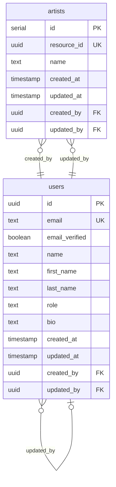

# Tables

| Name | Columns | Comment |
|------|---------|---------|
| [artists](#artists) | 7 |  |
| [users](#users) | 12 |  |

---

## artists

### Columns

| Name | Type | Default | Nullable | Children | Parents | Comment |
|------|------|---------|----------|----------|---------|---------|
| **id** | serial | - | NO | - | - | - |
| resource_id | uuid | `uuidv7()` | NO | - | - | - |
| name | text | - | NO | - | - | - |
| created_at | timestamp | `now()` | NO | - | - | - |
| updated_at | timestamp | `now()` | NO | - | - | - |
| created_by | uuid | - | NO | - | [users.id](#users) | - |
| updated_by | uuid | - | NO | - | [users.id](#users) | - |

### Constraints

| Name | Type | Definition |
|------|------|------------|
| fk_created_by_users | FOREIGN KEY | (created_by) → users(id) |
| fk_updated_by_users | FOREIGN KEY | (updated_by) → users(id) |

### Relations

| Parent | Child | Type |
|--------|-------|------|
| [users.id](#users) | **[artists.created_by](#artists)** | Many to One |
| [users.id](#users) | **[artists.updated_by](#artists)** | Many to One |

---

## users

### Columns

| Name | Type | Default | Nullable | Children | Parents | Comment |
|------|------|---------|----------|----------|---------|---------|
| **id** | uuid | `uuidv7()` | NO | [artists.created_by](#artists), [artists.updated_by](#artists), [users.created_by](#users), [users.updated_by](#users) | - | - |
| email | text | - | NO | - | - | - |
| email_verified | boolean | `false` | NO | - | - | - |
| name | text | - | NO | - | - | - |
| first_name | text | - | YES | - | - | - |
| last_name | text | - | YES | - | - | - |
| role | text | `'user'` | NO | - | - | - |
| bio | text | - | YES | - | - | - |
| created_at | timestamp | `now()` | NO | - | - | - |
| updated_at | timestamp | `now()` | NO | - | - | - |
| created_by | uuid | - | YES | - | [users.id](#users) | - |
| updated_by | uuid | - | YES | - | [users.id](#users) | - |

### Constraints

| Name | Type | Definition |
|------|------|------------|
| fk_created_by_users | FOREIGN KEY | (created_by) → users(id) |
| fk_updated_by_users | FOREIGN KEY | (updated_by) → users(id) |

### Relations

| Parent | Child | Type |
|--------|-------|------|
| **[users.id](#users)** | [artists.created_by](#artists) | Many to One |
| **[users.id](#users)** | [artists.updated_by](#artists) | Many to One |
| **[users.id](#users)** | [users.created_by](#users) | Many to One |
| **[users.id](#users)** | [users.updated_by](#users) | Many to One |

---

## ER Diagram

