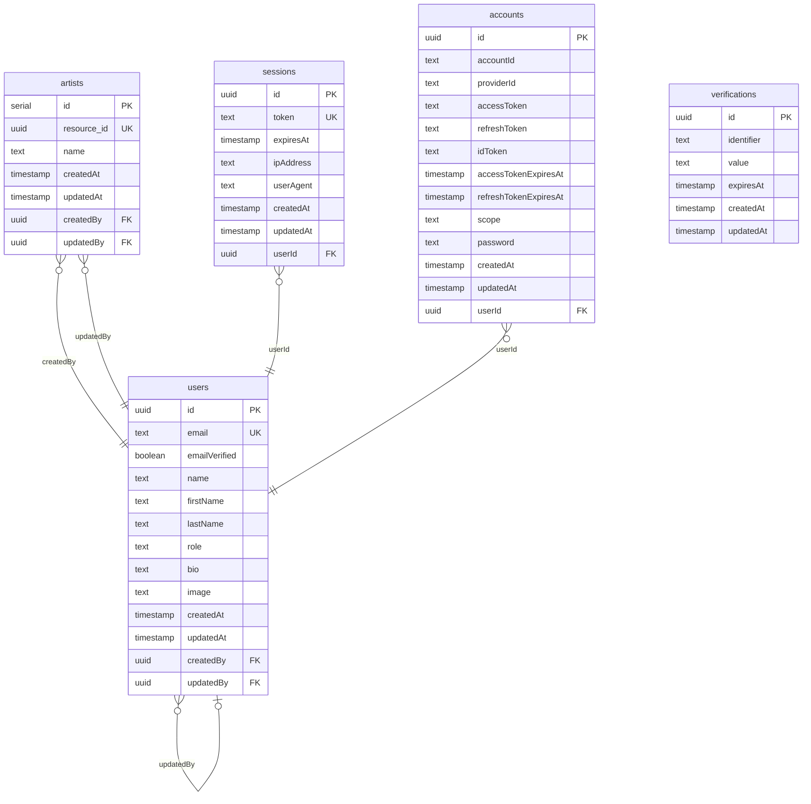

# Tables

| Name | Columns | Comment |
|------|---------|---------|
| [accounts](#accounts) | 13 |  |
| [artists](#artists) | 7 |  |
| [sessions](#sessions) | 8 |  |
| [users](#users) | 13 |  |
| [verifications](#verifications) | 6 |  |

---

## accounts

### Columns

| Name | Type | Default | Nullable | Children | Parents | Comment |
|------|------|---------|----------|----------|---------|---------|
| **id** | uuid | `uuidv7()` | NO | - | - | - |
| accountId | text | - | NO | - | - | - |
| providerId | text | - | NO | - | - | - |
| accessToken | text | - | YES | - | - | - |
| refreshToken | text | - | YES | - | - | - |
| idToken | text | - | YES | - | - | - |
| accessTokenExpiresAt | timestamp | - | YES | - | - | - |
| refreshTokenExpiresAt | timestamp | - | YES | - | - | - |
| scope | text | - | YES | - | - | - |
| password | text | - | YES | - | - | - |
| createdAt | timestamp | `now()` | NO | - | - | - |
| updatedAt | timestamp | `now()` | NO | - | - | - |
| userId | uuid | - | NO | - | [users.id](#users) | - |

### Constraints

| Name | Type | Definition |
|------|------|------------|
| fk_userId_users | FOREIGN KEY | (userId) → users(id) |

### Indexes

| Name | Columns | Unique | Type |
|------|---------|--------|------|
| idx_userId | userId | NO | - |

### Relations

| Parent | Child | Type |
|--------|-------|------|
| [users.id](#users) | **[accounts.userId](#accounts)** | Many to One |

---

## artists

### Columns

| Name | Type | Default | Nullable | Children | Parents | Comment |
|------|------|---------|----------|----------|---------|---------|
| **id** | serial | - | NO | - | - | - |
| resource_id | uuid | `uuidv7()` | NO | - | - | - |
| name | text | - | NO | - | - | - |
| createdAt | timestamp | `now()` | NO | - | - | - |
| updatedAt | timestamp | `now()` | NO | - | - | - |
| createdBy | uuid | - | NO | - | [users.id](#users) | - |
| updatedBy | uuid | - | NO | - | [users.id](#users) | - |

### Constraints

| Name | Type | Definition |
|------|------|------------|
| fk_createdBy_users | FOREIGN KEY | (createdBy) → users(id) |
| fk_updatedBy_users | FOREIGN KEY | (updatedBy) → users(id) |

### Relations

| Parent | Child | Type |
|--------|-------|------|
| [users.id](#users) | **[artists.createdBy](#artists)** | Many to One |
| [users.id](#users) | **[artists.updatedBy](#artists)** | Many to One |

---

## sessions

### Columns

| Name | Type | Default | Nullable | Children | Parents | Comment |
|------|------|---------|----------|----------|---------|---------|
| **id** | uuid | `uuidv7()` | NO | - | - | - |
| token | text | - | NO | - | - | - |
| expiresAt | timestamp | - | NO | - | - | - |
| ipAddress | text | - | YES | - | - | - |
| userAgent | text | - | YES | - | - | - |
| createdAt | timestamp | `now()` | NO | - | - | - |
| updatedAt | timestamp | `now()` | NO | - | - | - |
| userId | uuid | - | NO | - | [users.id](#users) | - |

### Constraints

| Name | Type | Definition |
|------|------|------------|
| fk_userId_users | FOREIGN KEY | (userId) → users(id) |

### Indexes

| Name | Columns | Unique | Type |
|------|---------|--------|------|
| idx_userId | userId | NO | - |

### Relations

| Parent | Child | Type |
|--------|-------|------|
| [users.id](#users) | **[sessions.userId](#sessions)** | Many to One |

---

## users

### Columns

| Name | Type | Default | Nullable | Children | Parents | Comment |
|------|------|---------|----------|----------|---------|---------|
| **id** | uuid | `uuidv7()` | NO | [users.createdBy](#users), [users.updatedBy](#users), [artists.createdBy](#artists), [artists.updatedBy](#artists), [sessions.userId](#sessions), [accounts.userId](#accounts) | - | - |
| email | text | - | NO | - | - | - |
| emailVerified | boolean | `false` | NO | - | - | - |
| name | text | - | NO | - | - | - |
| firstName | text | - | YES | - | - | - |
| lastName | text | - | YES | - | - | - |
| role | text | `'user'` | NO | - | - | - |
| bio | text | - | YES | - | - | - |
| image | text | - | YES | - | - | - |
| createdAt | timestamp | `now()` | NO | - | - | - |
| updatedAt | timestamp | `now()` | NO | - | - | - |
| createdBy | uuid | - | YES | - | [users.id](#users) | - |
| updatedBy | uuid | - | YES | - | [users.id](#users) | - |

### Constraints

| Name | Type | Definition |
|------|------|------------|
| fk_createdBy_users | FOREIGN KEY | (createdBy) → users(id) |
| fk_updatedBy_users | FOREIGN KEY | (updatedBy) → users(id) |

### Relations

| Parent | Child | Type |
|--------|-------|------|
| **[users.id](#users)** | [users.createdBy](#users) | Many to One |
| **[users.id](#users)** | [users.updatedBy](#users) | Many to One |
| **[users.id](#users)** | [artists.createdBy](#artists) | Many to One |
| **[users.id](#users)** | [artists.updatedBy](#artists) | Many to One |
| **[users.id](#users)** | [sessions.userId](#sessions) | Many to One |
| **[users.id](#users)** | [accounts.userId](#accounts) | Many to One |

---

## verifications

### Columns

| Name | Type | Default | Nullable | Children | Parents | Comment |
|------|------|---------|----------|----------|---------|---------|
| **id** | uuid | `uuidv7()` | NO | - | - | - |
| identifier | text | - | NO | - | - | - |
| value | text | - | NO | - | - | - |
| expiresAt | timestamp | - | NO | - | - | - |
| createdAt | timestamp | `now()` | NO | - | - | - |
| updatedAt | timestamp | `now()` | NO | - | - | - |

### Indexes

| Name | Columns | Unique | Type |
|------|---------|--------|------|
| idx_identifier | identifier | NO | - |

---

## ER Diagram

