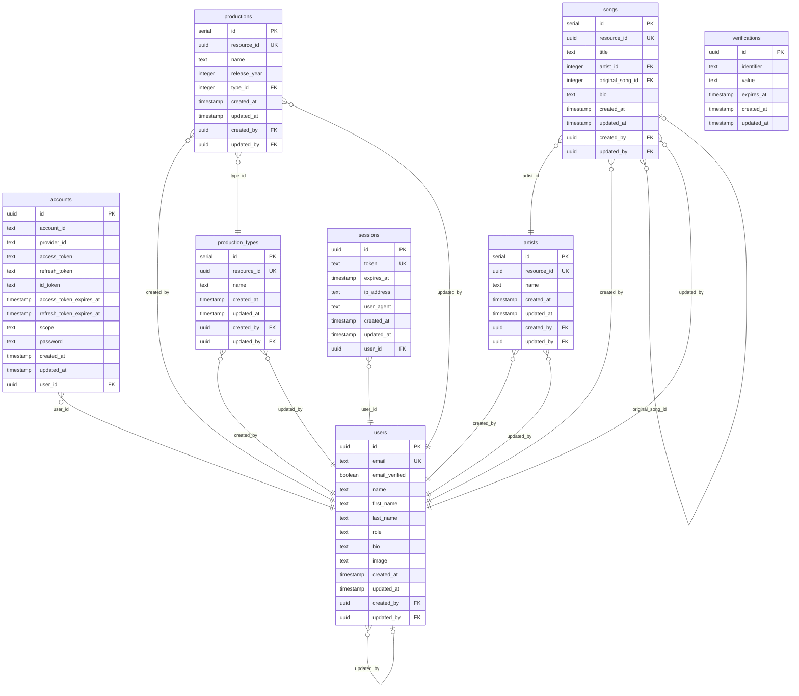

# Tables

| Name | Columns |
|------|---------|
| [accounts](#accounts) | 13 |
| [artists](#artists) | 7 |
| [production_types](#production_types) | 7 |
| [productions](#productions) | 9 |
| [sessions](#sessions) | 8 |
| [songs](#songs) | 10 |
| [users](#users) | 13 |
| [verifications](#verifications) | 6 |

---

## accounts

### Columns

| Name | Type | Default | Nullable | Children | Parents |
|------|------|---------|----------|----------|---------|
| **id** | uuid | `uuidv7()` | NO | - | - |
| account_id | text | - | NO | - | - |
| provider_id | text | - | NO | - | - |
| access_token | text | - | YES | - | - |
| refresh_token | text | - | YES | - | - |
| id_token | text | - | YES | - | - |
| access_token_expires_at | timestamp | - | YES | - | - |
| refresh_token_expires_at | timestamp | - | YES | - | - |
| scope | text | - | YES | - | - |
| password | text | - | YES | - | - |
| created_at | timestamp | `now()` | NO | - | - |
| updated_at | timestamp | `now()` | NO | - | - |
| user_id | uuid | - | NO | - | [users.id](#users) |

### Constraints

| Name | Type | Definition |
|------|------|------------|
| accounts_user_id_users_id_fk | FOREIGN KEY | (user_id) → users(id) |

### Indexes

| Name | Columns | Unique | Type |
|------|---------|--------|------|
| accounts_user_id_index | user_id | NO | btree |

### Relations

| Parent | Child | Type |
|--------|-------|------|
| [users.id](#users) | **[accounts.user_id](#accounts)** | Many to One |

---

## artists

### Columns

| Name | Type | Default | Nullable | Children | Parents |
|------|------|---------|----------|----------|---------|
| **id** | serial | - | NO | [songs.artist_id](#songs) | - |
| resource_id | uuid | `uuidv7()` | NO | - | - |
| name | text | - | NO | - | - |
| created_at | timestamp | `now()` | NO | - | - |
| updated_at | timestamp | `now()` | NO | - | - |
| created_by | uuid | - | NO | - | [users.id](#users) |
| updated_by | uuid | - | NO | - | [users.id](#users) |

### Constraints

| Name | Type | Definition |
|------|------|------------|
| artists_created_by_users_id_fk | FOREIGN KEY | (created_by) → users(id) |
| artists_updated_by_users_id_fk | FOREIGN KEY | (updated_by) → users(id) |

### Relations

| Parent | Child | Type |
|--------|-------|------|
| **[artists.id](#artists)** | [songs.artist_id](#songs) | Many to One |
| [users.id](#users) | **[artists.created_by](#artists)** | Many to One |
| [users.id](#users) | **[artists.updated_by](#artists)** | Many to One |

---

## production_types

### Columns

| Name | Type | Default | Nullable | Children | Parents |
|------|------|---------|----------|----------|---------|
| **id** | serial | - | NO | [productions.type_id](#productions) | - |
| resource_id | uuid | `uuidv7()` | NO | - | - |
| name | text | - | NO | - | - |
| created_at | timestamp | `now()` | NO | - | - |
| updated_at | timestamp | `now()` | NO | - | - |
| created_by | uuid | - | NO | - | [users.id](#users) |
| updated_by | uuid | - | NO | - | [users.id](#users) |

### Constraints

| Name | Type | Definition |
|------|------|------------|
| production_types_created_by_users_id_fk | FOREIGN KEY | (created_by) → users(id) |
| production_types_updated_by_users_id_fk | FOREIGN KEY | (updated_by) → users(id) |

### Relations

| Parent | Child | Type |
|--------|-------|------|
| **[production_types.id](#production_types)** | [productions.type_id](#productions) | Many to One |
| [users.id](#users) | **[production_types.created_by](#production_types)** | Many to One |
| [users.id](#users) | **[production_types.updated_by](#production_types)** | Many to One |

---

## productions

### Columns

| Name | Type | Default | Nullable | Children | Parents |
|------|------|---------|----------|----------|---------|
| **id** | serial | - | NO | - | - |
| resource_id | uuid | `uuidv7()` | NO | - | - |
| name | text | - | NO | - | - |
| release_year | integer | - | NO | - | - |
| type_id | integer | - | NO | - | [production_types.id](#production_types) |
| created_at | timestamp | `now()` | NO | - | - |
| updated_at | timestamp | `now()` | NO | - | - |
| created_by | uuid | - | NO | - | [users.id](#users) |
| updated_by | uuid | - | NO | - | [users.id](#users) |

### Constraints

| Name | Type | Definition |
|------|------|------------|
| productions_type_id_production_types_id_fk | FOREIGN KEY | (type_id) → production_types(id) |
| productions_created_by_users_id_fk | FOREIGN KEY | (created_by) → users(id) |
| productions_updated_by_users_id_fk | FOREIGN KEY | (updated_by) → users(id) |

### Relations

| Parent | Child | Type |
|--------|-------|------|
| [users.id](#users) | **[productions.created_by](#productions)** | Many to One |
| [production_types.id](#production_types) | **[productions.type_id](#productions)** | Many to One |
| [users.id](#users) | **[productions.updated_by](#productions)** | Many to One |

---

## sessions

### Columns

| Name | Type | Default | Nullable | Children | Parents |
|------|------|---------|----------|----------|---------|
| **id** | uuid | `uuidv7()` | NO | - | - |
| token | text | - | NO | - | - |
| expires_at | timestamp | - | NO | - | - |
| ip_address | text | - | YES | - | - |
| user_agent | text | - | YES | - | - |
| created_at | timestamp | `now()` | NO | - | - |
| updated_at | timestamp | `now()` | NO | - | - |
| user_id | uuid | - | NO | - | [users.id](#users) |

### Constraints

| Name | Type | Definition |
|------|------|------------|
| sessions_user_id_users_id_fk | FOREIGN KEY | (user_id) → users(id) |

### Indexes

| Name | Columns | Unique | Type |
|------|---------|--------|------|
| sessions_user_id_index | user_id | NO | btree |

### Relations

| Parent | Child | Type |
|--------|-------|------|
| [users.id](#users) | **[sessions.user_id](#sessions)** | Many to One |

---

## songs

### Columns

| Name | Type | Default | Nullable | Children | Parents |
|------|------|---------|----------|----------|---------|
| **id** | serial | - | NO | [songs.original_song_id](#songs) | - |
| resource_id | uuid | `uuidv7()` | NO | - | - |
| title | text | - | NO | - | - |
| artist_id | integer | - | NO | - | [artists.id](#artists) |
| original_song_id | integer | - | YES | - | [songs.id](#songs) |
| bio | text | - | YES | - | - |
| created_at | timestamp | `now()` | NO | - | - |
| updated_at | timestamp | `now()` | NO | - | - |
| created_by | uuid | - | NO | - | [users.id](#users) |
| updated_by | uuid | - | NO | - | [users.id](#users) |

### Constraints

| Name | Type | Definition |
|------|------|------------|
| songs_artist_id_artists_id_fk | FOREIGN KEY | (artist_id) → artists(id) |
| songs_original_song_id_songs_id_fk | FOREIGN KEY | (original_song_id) → songs(id) |
| songs_created_by_users_id_fk | FOREIGN KEY | (created_by) → users(id) |
| songs_updated_by_users_id_fk | FOREIGN KEY | (updated_by) → users(id) |

### Relations

| Parent | Child | Type |
|--------|-------|------|
| **[songs.id](#songs)** | [songs.original_song_id](#songs) | Many to One |
| [artists.id](#artists) | **[songs.artist_id](#songs)** | Many to One |
| [users.id](#users) | **[songs.created_by](#songs)** | Many to One |
| [songs.id](#songs) | **[songs.original_song_id](#songs)** | Many to One |
| [users.id](#users) | **[songs.updated_by](#songs)** | Many to One |

---

## users

### Columns

| Name | Type | Default | Nullable | Children | Parents |
|------|------|---------|----------|----------|---------|
| **id** | uuid | `uuidv7()` | NO | [accounts.user_id](#accounts), [artists.created_by](#artists), [artists.updated_by](#artists), [production_types.created_by](#production_types), [production_types.updated_by](#production_types), [productions.created_by](#productions), [productions.updated_by](#productions), [sessions.user_id](#sessions), [songs.created_by](#songs), [songs.updated_by](#songs), [users.created_by](#users), [users.updated_by](#users) | - |
| email | text | - | NO | - | - |
| email_verified | boolean | `false` | NO | - | - |
| name | text | - | NO | - | - |
| first_name | text | - | YES | - | - |
| last_name | text | - | YES | - | - |
| role | text | `'user'` | NO | - | - |
| bio | text | - | YES | - | - |
| image | text | - | YES | - | - |
| created_at | timestamp | `now()` | NO | - | - |
| updated_at | timestamp | `now()` | NO | - | - |
| created_by | uuid | - | YES | - | [users.id](#users) |
| updated_by | uuid | - | YES | - | [users.id](#users) |

### Constraints

| Name | Type | Definition |
|------|------|------------|
| users_created_by_users_id_fk | FOREIGN KEY | (created_by) → users(id) |
| users_updated_by_users_id_fk | FOREIGN KEY | (updated_by) → users(id) |

### Relations

| Parent | Child | Type |
|--------|-------|------|
| **[users.id](#users)** | [accounts.user_id](#accounts) | Many to One |
| **[users.id](#users)** | [artists.created_by](#artists) | Many to One |
| **[users.id](#users)** | [artists.updated_by](#artists) | Many to One |
| **[users.id](#users)** | [production_types.created_by](#production_types) | Many to One |
| **[users.id](#users)** | [production_types.updated_by](#production_types) | Many to One |
| **[users.id](#users)** | [productions.created_by](#productions) | Many to One |
| **[users.id](#users)** | [productions.updated_by](#productions) | Many to One |
| **[users.id](#users)** | [sessions.user_id](#sessions) | Many to One |
| **[users.id](#users)** | [songs.created_by](#songs) | Many to One |
| **[users.id](#users)** | [songs.updated_by](#songs) | Many to One |
| **[users.id](#users)** | [users.created_by](#users) | Many to One |
| **[users.id](#users)** | [users.updated_by](#users) | Many to One |
| [users.id](#users) | **[users.created_by](#users)** | Many to One |
| [users.id](#users) | **[users.updated_by](#users)** | Many to One |

---

## verifications

### Columns

| Name | Type | Default | Nullable | Children | Parents |
|------|------|---------|----------|----------|---------|
| **id** | uuid | `uuidv7()` | NO | - | - |
| identifier | text | - | NO | - | - |
| value | text | - | NO | - | - |
| expires_at | timestamp | - | NO | - | - |
| created_at | timestamp | `now()` | NO | - | - |
| updated_at | timestamp | `now()` | NO | - | - |

### Indexes

| Name | Columns | Unique | Type |
|------|---------|--------|------|
| verifications_identifier_index | identifier | NO | btree |

---

## ER Diagram

